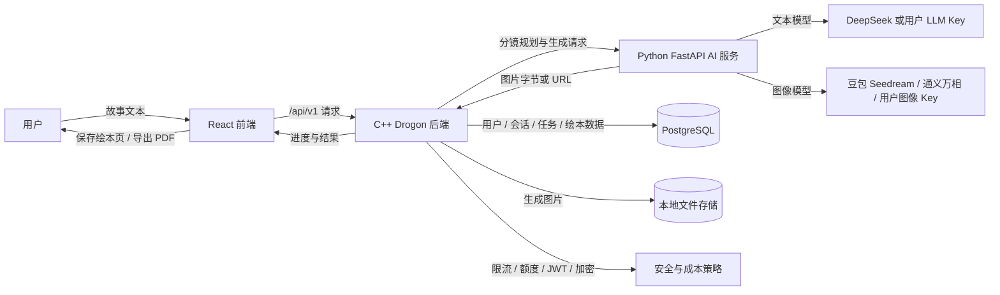

# StoryCanvas

> 基于生成式 AI 的儿童绘本智能创作与图像生成系统


---

## 项目简介

StoryCanvas 是一个面向儿童绘本创作场景的 Web 应用。用户输入一段故事文本后，系统可以生成分镜、批量生成风格一致的插画，并把结果保存为绘本页，最终导出多页 PDF。

系统把「故事构思 → 分镜拆分 → 图像生成 → 结果修正 → 绘本整理」串成一条完整链路，同时提供游客体验、账号体系、用户自带模型密钥（BYOK）、额度控制、接口限流和本地文件存储等能力。

---

## 核心能力

| 能力 | 说明 |
| --- | --- |
| 对话式多图创作 | 输入故事后先生成 N 格分镜，用户逐格确认或编辑，再一次性批量生成图片 |
| 同批次一致性 | 同批次共享角色设定、艺术风格、负向提示与随机种子，减少画面割裂 |
| 灵活生成额度 | 游客默认 1 张，注册用户单次 1–6 张，双项 BYOK 用户单次最多 12 张 |
| 单格修正 | 支持单张重画、下载、加入绘本，以及按批次查看进度和失败原因 |
| 绘本与作品库 | 创建绘本、管理页顺序、绑定生成图、复用历史图片，并导出多页 PDF |
| 游客优先体验 | 未登录也能体验生成；登录或注册后可认领游客期间产生的资源 |
| 账号与会话 | 邮箱/用户名注册登录、JWT 双 Token、刷新令牌、密码哈希与用户数据隔离 |
| BYOK | 用户可配置自己的 LLM / 图像 API Key；密文入库、脱敏回显、测试通过后凭短期票据保存 |
| 成本与稳定性 | 游客池/登录池每日额度、接口限流、429 提示、内容合规快速失败、日志不输出明文 Key |
| 离线 Mock 模式 | 内置 Mock LLM 与 Mock 图像 Provider，可生成真实 PNG，无需外部模型即可跑通完整链路 |

---

## 工作流程



系统采用模块化单体架构：

- **前端**：React + TypeScript，负责创作交互、进度轮询、结果预览、绘本页与 PDF 导出；
- **后端**：C++17 + Drogon，负责认证、业务编排、额度控制、任务状态、凭据加密与文件访问；
- **AI 服务**：Python + FastAPI，负责分镜拆分、Prompt 优化、Provider 适配与图像生成；
- **数据层**：PostgreSQL 保存结构化数据，本地 `storage/` 保存生成图片，Redis 作为可选缓存组件；
- **接入层**：Nginx 可选作为统一反向代理，容器环境由 Docker Compose 编排。

---

## 技术栈

| 层级 | 技术 |
| --- | --- |
| 前端 | React 18, TypeScript, Vite, Ant Design, Tailwind CSS, Zustand, jsPDF, html2canvas |
| 后端 | C++17, Drogon, CMake, OpenSSL, JWT, bcrypt, libpq |
| AI 服务 | Python 3.10+, FastAPI, Pydantic, httpx, pytest |
| 数据库 | PostgreSQL 15 |
| 缓存 | Redis 7（可选） |
| 文件存储 | 本地目录 `storage/`，按用户与绘本分层 |
| AI 文本模型 | DeepSeek, OpenAI Compatible / BYOK, Mock |
| AI 图像模型 | 豆包·Seedream, 通义万相, BYOK, Mock |
| 测试 | GoogleTest / ctest, pytest, Vitest, React Testing Library |
| 部署 | Docker, Docker Compose, Nginx |

---

## 快速开始

### 1. 环境要求

- Linux 或 WSL2 Ubuntu 22.04
- GCC/G++ 11+
- CMake 3.16+
- Python 3.10+
- Node.js 18+
- Docker 与 Docker Compose 插件
- PostgreSQL 15（使用容器时由 Compose 提供）
- Redis 7（可选，使用容器时由 Compose 提供）

### 2. 克隆与初始化

```bash
git clone https://github.com/PlutoKrimodo/StoryCanvas.git
cd StoryCanvas

chmod +x scripts/*.sh
./scripts/setup.sh
```

`scripts/setup.sh` 会完成：

- 生成根目录 `.env` 和 `ai-service/.env`；
- 自动生成 `ENCRYPTION_KEY`（需要本机安装 `openssl`）；
- 启用 `.githooks` 中的密钥扫描钩子；
- 创建 `backend/build` 并执行 CMake 配置；
- 创建 Python 虚拟环境并安装 AI 服务依赖；
- 安装前端依赖；
- 创建 `storage/`、`logs/`、`nginx/ssl/` 等运行目录。

随后编辑根目录 `.env`，至少填写：

```text
DB_PASSWORD=
JWT_SECRET=
AI_SERVICE_API_KEY=
ENCRYPTION_KEY=
```

其中：

- `JWT_SECRET` 可用 `openssl rand -hex 32` 生成；
- `ENCRYPTION_KEY` 可用 `openssl rand -base64 32` 生成，`setup.sh` 通常已自动生成；
- `AI_SERVICE_API_KEY` 是后端访问 AI 服务的内部鉴权密钥，需要与 `ai-service/.env` 中的 `INTERNAL_API_KEY` 保持一致；
- 根目录 `.env` 与 `ai-service/.env` 都是本地配置，不应进入版本库。

### 3. 使用 Docker Compose 启动

若尚未运行 `scripts/setup.sh`，先复制配置模板：

```bash
cp .env.example .env
cp ai-service/.env.example ai-service/.env
```

按上节说明填写必填变量后启动：

```bash
docker compose up -d --build
```

> 旧版环境若没有 `docker compose` 子命令，可使用 `docker-compose up -d --build`。

常用操作：

```bash
docker compose ps
docker compose logs -f
docker compose down
```

默认访问入口：

| 服务 | 地址 |
| --- | --- |
| 前端 | `http://localhost:5173` |
| 后端健康检查 | `http://localhost:8080/health` |
| AI 服务健康检查 | `http://127.0.0.1:8000/api/v1/health/` |
| Nginx 反向代理（可选） | `http://localhost` |

`nginx` 服务默认监听 80 端口；HTTPS 段在 `nginx/nginx.conf` 中默认注释，放入证书后可自行启用。

### 4. 本地开发启动

如需分别启动三端并观察日志，可使用：

```bash
./scripts/start_all.sh --rebuild --open
```

常用参数：

```text
--no-ai           不启动 AI 服务
--no-frontend     不启动前端
--rebuild         强制重新构建后端
--init-db         用 psql 执行 sql/init.sql
--verify          启动后运行基础链路自检
--open            尝试自动打开浏览器
--down            停止 Compose 服务
```

手动启动时的端口与 Compose 一致：

- 后端：`http://localhost:8080`
- AI 服务：`http://127.0.0.1:8000`
- 前端：`http://localhost:5173`

若使用已有数据库，请按 `sql/` 下的迁移脚本补齐 BYOK、会话、页图片、额度拆分与任务状态等字段。

---

## 配置说明

### 根目录 `.env`

根目录 `.env.example` 是公共配置模板，主要变量如下：

| 类别 | 变量 | 说明 |
| --- | --- | --- |
| 数据库 | `DB_HOST`, `DB_PORT`, `DB_NAME`, `DB_USER`, `DB_PASSWORD` | PostgreSQL 连接配置 |
| JWT | `JWT_SECRET`, `JWT_ACCESS_TOKEN_EXPIRY`, `JWT_REFRESH_TOKEN_EXPIRY` | 访问令牌、刷新令牌与签名密钥 |
| 游客 | `GUEST_GENERATION_QUOTA`, `GUEST_DAILY_GENERATION_CAP` | 游客个人额度与游客池每日额度 |
| 登录用户 | `USER_DAILY_GENERATION_CAP` | 所有登录用户共享的每日额度 |
| 限流 | `RATE_LIMIT_ENABLED`, `RATE_LIMIT_*_PER_MIN` | 匿名、认证、生成、游客会话、凭据测试等限流档位 |
| BYOK | `BYOK_ENABLED`, `ENCRYPTION_KEY` | BYOK 开关与用户 API Key 加密主密钥 |
| 内部调用 | `AI_SERVICE_URL`, `AI_SERVICE_API_KEY`, `AI_SERVICE_TIMEOUT` | 后端调用 AI 服务的地址、鉴权与超时 |
| 系统模型 | `LLM_PROVIDER`, `IMAGE_PROVIDER`, `DEEPSEEK_API_KEY`, `ARK_API_KEY`, `DASHSCOPE_API_KEY` | 未使用 BYOK 或 BYOK 关闭时的系统 Provider 配置 |
| 文件 | `STORAGE_PATH` | 后端与 AI 服务共享的图片目录，两者必须指向同一位置 |
| 端口 | `BACKEND_PORT`, `AI_SERVICE_PORT`, `FRONTEND_PORT` | 默认分别为 8080 / 8000 / 5173 |

`docker-compose.yml` 对密钥类变量使用 `${VAR:?}` 约束：缺少 `DB_PASSWORD`、`JWT_SECRET` 或 `AI_SERVICE_API_KEY` 时会直接拒绝启动；`.env.example` 中的 `change_me` 一类占位值也必须替换为随机值。

### AI 服务 `.env`

`ai-service/.env.example` 用于本地直接启动 AI 服务，主要包含：

- `LLM_PROVIDER`：`deepseek` / `mock`
- `IMAGE_PROVIDER`：`doubao` / `wanx` / `mock`
- `DEEPSEEK_API_KEY`、`ARK_API_KEY`、`DASHSCOPE_API_KEY`：系统模型密钥
- `INTERNAL_API_KEY`：与根目录 `AI_SERVICE_API_KEY` 保持一致
- `STORAGE_PATH`：与后端共享同一目录
- `MOCK_IMAGE_DELAY`：Mock 图像生成延迟，便于观察进度轮询

Docker Compose 会直接把根目录 `.env` 中的变量注入 AI 服务容器；本地单独运行 AI 服务时才需要维护 `ai-service/.env`。

### 离线 Mock 模式

无需外部模型密钥即可运行：

```bash
LLM_PROVIDER=mock IMAGE_PROVIDER=mock
```

Mock LLM 返回结构化分镜，Mock 图像 Provider 会生成真实 PNG 文件，因此「故事 → 分镜 → 图片 → 落盘 → 预览 → 保存绘本 → 导出 PDF」整条链路都可以在本地闭环。

---

## 用户自带 API Key（BYOK）

登录用户可在「个人中心 → 我的 AI API Key」配置自己的 LLM 与图像模型密钥。

接入流程：

1. 选择厂商，例如 DeepSeek、豆包·Seedream、OpenAI Compatible、通义千问、智谱 GLM 等；
2. 粘贴 API Key；Base URL 与推荐模型由服务端目录自动带出，自定义厂商可展开高级设置；
3. 点击「保存并验证」：服务端先做连通性测试，测试通过后签发短期验证票据，保存请求必须携带该票据。

当前连通性校验行为：

| 能力 | 校验方式 |
| --- | --- |
| LLM | 发起一次 `max_tokens=1` 的真实探测 |
| 图像 | 生成一张 1K 测试图完成连通性校验，通常会计费一次；测试图不落盘、不下载 |

凭证门禁：

- 验证票据有效期约 10 分钟，绑定 userId、能力、厂商、Base URL、模型与 Key 哈希；
- 修改任一配置或重新选择能力后，前端会丢弃旧票据，必须重新测试；
- 直接调用 `PUT /users/me/ai-credentials/{capability}` 而不先测试会返回 422 / `BYOK_VERIFICATION_REQUIRED`。

安全与额度规则：

- Key 以 **AES-256-GCM 密文**入库，接口只回显 `sk-****abcd` 一类脱敏信息；
- 前端不持久化明文 Key，日志不记录请求体、请求头或厂商原始响应；
- 双项 BYOK 都配置时，该用户任务不占游客池/登录池每日额度；
- 只配置一项时，未配置的能力仍走系统 Key，任务照常计入额度；
- 已配置能力调用失败时任务直接失败并提示更新 Key，不静默回退系统 Key；
- `BYOK_ENABLED=true` 时，`ENCRYPTION_KEY` 缺失、过短或仍是 `change_me` 等占位值会导致后端启动失败；
- 轮换 `ENCRYPTION_KEY` 会导致旧密文无法解密，用户需要重新保存 Key；
- 设置 `BYOK_ENABLED=false` 可关闭整套 BYOK 接口并让所有请求回到系统 Key。

---

## 对话式多图创作

1. 输入连续故事，选择风格、尺寸与张数；游客仅 1 张，注册用户 1–6 张，双项 BYOK 最多 12 张；
2. AI 先返回 N 格分镜，用户可逐格编辑；确认前不会产生图像费用；
3. 确认后一次生成 N 张，同批次共享角色设定、风格、负向提示与 seed；
4. 每张图可单独下载、加入绘本或重画，整组可按顺序写入绘本连续页；
5. 登录用户的会话与分镜持久化，可在历史抽屉回看续画；游客仅保留当前页面内存。

旧 `POST /generation` 单图接口仍保留，历史任务不受影响。

---

## API 概览

- Base URL：`http://localhost:8080/api/v1`
- 认证方式：JWT Bearer Token
- 通用响应：`{ "code": 200, "message": "success", "data": {} }`

| 模块 | 典型接口 | 说明 |
| --- | --- | --- |
| 认证 | `/auth/register`, `/auth/login`, `/auth/refresh`, `/auth/logout` | 注册、登录、刷新与退出 |
| 游客 | `/auth/guest`, 登录/注册时携带 `guest_id` | 游客会话与产物认领 |
| 用户 | `/users/me` | 用户信息与密码管理 |
| BYOK | `/users/me/ai-credentials` | 凭据概览、厂商目录、保存、删除与测试 |
| 绘本 | `/books` | 绘本创建、列表、详情、更新与删除 |
| 页容器 | `/books/{id}/pages` | 生成图绑定到页、页列表与页顺序 |
| 会话 | `/conversations` | 创作会话与消息历史 |
| 分镜 | `/generation/plans` | 创建与更新分镜方案 |
| 批次 | `/generation/batches` | 启动批次、查询进度、取消批次、单格重画 |
| 图片 | `/images` | 图片信息、下载、删除与列表 |
| 健康检查 | `/health` | 服务健康状态 |

完整接口字段、状态码与安全要求见 [REST API 设计](docs/04-REST-API设计.md)。

---

## 项目结构

```text
StoryCanvas/
├── backend/                 # C++17 / Drogon 后端
│   ├── controllers/         #   HTTP 控制器
│   ├── services/            #   业务逻辑层
│   ├── repositories/        #   数据访问层
│   ├── models/              #   数据模型
│   ├── filters/             #   CORS、JWT、限流等过滤器
│   ├── utils/               #   配置、JWT、密码、加密、限流工具
│   ├── tests/               #   GoogleTest 单元测试
│   └── config/config.json   #   非敏感默认值
├── ai-service/              # Python / FastAPI AI 服务
│   ├── app/api/             #   HTTP 接口
│   ├── app/services/        #   文本分析、Prompt 优化、图像生成编排
│   ├── app/providers/       #   LLM / 图像 / Mock / BYOK Provider
│   ├── app/prompts/         #   Prompt 与风格模板
│   └── tests/               #   pytest 单元测试
├── frontend/                # React / TypeScript 前端
│   └── src/                 #   api / stores / hooks / components / pages / theme / utils
├── nginx/                   # 可选反向代理配置
├── sql/                     # 初始化与增量迁移脚本
├── scripts/                 # 初始化、启动与自检脚本
├── docs/                    # 架构、接口、数据库、安全与测试文档
├── storage/                 # 本地生成图片
├── docker-compose.yml       # 容器编排
├── .env.example             # 根目录环境变量模板
└── README.md
```

---

## 详细文档

| 文档 | 内容 |
| --- | --- |
| [项目方案总览](docs/00-项目方案总览.md) | 项目定位、范围与整体方案 |
| [软件需求规格说明书](docs/01-SRS-软件需求规格说明书.md) | 功能需求、质量需求与约束 |
| [系统总体架构设计](docs/02-系统总体架构设计.md) | 分层架构、模块职责与部署视图 |
| [数据库设计](docs/03-数据库设计.md) | ER 图、表结构、索引与约束 |
| [REST API 设计](docs/04-REST-API设计.md) | 接口路径、请求响应、错误码与安全要求 |
| [C++ 后端项目结构](docs/05-CppBackend项目结构.md) | 后端目录与分层设计 |
| [Python AI Service 结构](docs/06-PythonAIService结构.md) | AI 服务模块与 Provider 设计 |
| [前端架构设计](docs/07-前端架构设计.md) | 前端页面、状态与组件设计 |
| [AI 异步任务机制](docs/08-AI异步任务机制.md) | 任务状态、轮询、失败与重试策略 |
| [文件存储方案](docs/09-文件存储方案.md) | 图片落盘路径、访问与清理策略 |
| [安全机制设计](docs/10-安全机制设计.md) | 认证、授权、加密、限流与输入安全 |
| [测试方案](docs/11-测试方案.md) | 测试分层、工具与用例 |
| [WSL 开发环境](docs/14-WSL开发环境.md) | 本地开发环境说明 |
| [Git 项目组织](docs/15-Git项目组织.md) | Git 工作流与钩子约定 |
| [项目实施方案](docs/16-项目实施方案.md) | 详细实现方案与约束说明 |
| [前端视觉现代化方案](docs/17-前端视觉现代化方案.md) | 设计令牌、主题与视觉规范 |

---

## 测试

```bash
# 后端单元测试
cd backend/build
cmake .. && make -j"$(nproc)" && ctest --output-on-failure

# AI 服务单元测试
cd ../../ai-service
./venv/bin/python -m pytest

# 前端类型检查与组件测试
cd ../frontend
npm run typecheck && npm test
```

服务启动后可按需运行端到端自检脚本：

```bash
./scripts/verify_m1.sh            # 用户与鉴权链路
./scripts/verify_m2.sh            # 绘本管理链路
./scripts/verify_m3.sh            # 文本解析链路
./scripts/verify_m4.sh            # 图像生成链路
./scripts/verify_guest.sh         # 游客生成与认领
./scripts/verify_quota_split.sh   # 游客池 / 登录池额度拆分
./scripts/verify_byok.sh          # BYOK 凭据与加密
./scripts/verify_chat.sh          # 对话式多图与整组入绘本
./scripts/verify_security.sh      # 写接口权限、限流与超限提示
```

---

## 安全说明

- `.env`、真实 API Key、日志、`storage/` 中的生成资源与本地 CLI 状态文件不进入版本库；
- `.githooks/pre-commit` 与 `.githooks/pre-push` 会在提交与推送前扫描疑似密钥；
- 密码使用 bcrypt 哈希，会话使用 JWT 双 Token；
- 用户 BYOK Key 使用 AES-256-GCM 信封加密，密文绑定用户与能力；
- 保存前必须完成真实连通性测试，服务端签发短期 HMAC 验证票据；保存时校验票据签名、过期时间与配置哈希，防止直接 PUT 绕过；
- 前端错误日志只记录 HTTP 状态和 message，不打印含请求体的 AxiosError；
- 自定义 Base URL 会校验 HTTPS、端口、userinfo、查询参数与公网地址，降低 SSRF 风险；
- 登录、游客会话、生成、重画与凭据测试均有独立限流档位；
- 内容合规失败快速返回可读原因，不自动重试；
- 双项 BYOK 任务不计入系统 Key 额度；失败任务仍按快照保留额度归属。

---

## 贡献

欢迎通过 Issue 和 Pull Request 参与改进。

贡献前请确认：

- 不提交 `.env`、真实厂商 Key、用户 BYOK Key、证书、日志或生成图片；
- 后端、AI 服务与前端相关测试可通过；
- 涉及接口变更时同步更新 `docs/04-REST-API设计.md`；
- 涉及数据模型变更时补充 `sql/` 下的迁移脚本。

---

## 许可证

本项目采用 MIT 许可证。

---

## 致谢

- [Drogon Framework](https://github.com/drogonframework/drogon)
- [FastAPI](https://fastapi.tiangolo.com/)
- [React](https://react.dev/)
- [Ant Design](https://ant.design/)
- [PostgreSQL](https://www.postgresql.org/)
- [Docker](https://www.docker.com/)
